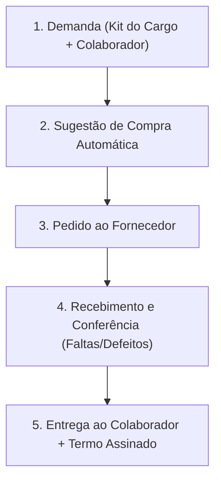

# Manual Operacional — Controle de Uniformes

Este manual orienta o fluxo diário de uso do sistema para resolver o caos de faltas, tamanhos errados e descontrole de entregas.

---

## 1. Fluxo do Sistema em 5 Etapas

---

## 2. Configurações Iniciais (Passo a Passo)

Antes de operar, faça essas configurações uma única vez em **Cadastros**:

1. **Grades de Tamanho:** O sistema já vem com Camisa (PP a XGG), Calça (36 a 56), Calçado (34 a 46) e Tamanho Único. Se tiver EPIs ou outros itens (ex.: Luvas P/M/G), configure aqui.
2. **Itens:** Cadastre os materiais fornecidos (ex.: *Camisa polo*, *Calça operacional*, *Botina de segurança*, *Boné*).
3. **Cargos e Kits:**
   - Cadastre a função (ex.: *Vigilante*, *Auxiliar de Limpeza*, *Porteiro*).
   - Defina o **Kit do Cargo**: quais itens a função tem direito, a quantidade e a **periodicidade em meses**.
   - *Exemplo:* 3 Camisas (a cada 6 meses), 2 Calças (a cada 6 meses), 1 Botina (a cada 12 meses), 1 Jaqueta (a cada 0 meses = entrega única).
4. **Fornecedores:** Cadastre as confecções/fornecedores parceiros.

---

## 3. Cadastro e Ficha do Colaborador

No menu **Colaboradores > + Novo colaborador**:
- Preencha Matrícula, Nome, Cargo, Posto de Trabalho e Data de Admissão.
- **Tamanhos:** Selecione o tamanho de camisa, calça e calçado daquele colaborador.
- **Ficha Individual:** Ao abrir a ficha de qualquer colaborador, o sistema mostra:
  - O que ele tem direito no ciclo atual;
  - O que já foi entregue;
  - O que **ainda está pendente**;
  - O histórico completo de quem entregou e quando.

---

## 4. Como Comprar: Sugestão Automática e Pedidos

Nunca mais calcule em cadernos ou planilhas soltas quanto comprar:

1. Acesse o menu **Sugestão de compra**.
2. O sistema calcula a necessidade em tempo real com a fórmula:
   $$\text{Comprar} = \text{Pendências Atuais} + \text{Trocas dos Próximos 60 Dias} - \text{Estoque Físico} - \text{Saldo já Pedido}$$
3. Se houver colaboradores sem tamanho cadastrado, o sistema emite um alerta em destaque para você preencher antes de pedir.
4. Ajuste as quantidades se desejar e clique em **Criar pedido com selecionados**.
5. O pedido será registrado com o status **Aberto**, alimentando a previsão da cadeia.

---

## 5. Como Receber do Fornecedor (Conferência Rigorosa)

Este ponto resolve o problema de **"o fornecedor entregou incompleto ou em tamanhos errados"**:

1. Vá em **Recebimentos > + Registrar recebimento**.
2. Selecione o **Pedido**. A tela carrega automaticamente tudo o que o fornecedor deveria entregar e o saldo pendente.
3. Conforme for abrindo os pacotes:
   - **Quantidade Recebida:** Digite quantas peças vieram.
   - **Veio peça com defeito / costura rasgada?** Digite em **Rejeitado** e informe o motivo. Peças rejeitadas **não entram no estoque** e ficam pendentes com o fornecedor.
   - **O fornecedor mandou um tamanho que não foi pedido?** Clique em **Adicionar item não previsto** e registre.
4. Ao confirmar o recebimento:
   - As peças aceitas entram no estoque automaticamente;
   - O saldo que faltou continua em aberto com alerta de cobrança no pedido;
   - Todas as divergências ficam documentadas com data e número de NF.

---

## 6. Entrega ao Colaborador e Termo de Recebimento

Quando o colaborador for retirar o uniforme:

1. Vá em **Entregas > + Nova entrega** (ou clique em **Entregar** direto na ficha dele).
2. Selecione o colaborador.
3. O sistema **preenche automaticamente a lista com o que ele tem direito a receber** e avisa quanto há em estoque de cada item no tamanho dele.
4. Se for substituição por extravio ou dano de trabalho (fora do ciclo normal), mude o motivo para **Substituição** (assim não queima o direito futuro do ciclo dele).
5. Clique em **Confirmar entrega**:
   - O estoque dá baixa na hora;
   - A pendência do colaborador é zerada ou reduzida;
   - Abre imediatamente a tela do **Termo de Recebimento**.
6. Clique em **Imprimir / Salvar PDF** para colher a assinatura física do colaborador.

---

## 7. Como Migrar as Planilhas Atuais (Importação)

Para não começar do zero digitando colaborador por colaborador:

1. Abra a planilha do Google vinculada ao sistema.
2. Você verá três abas amarelas no final:
   - `Importar_Colaboradores`: Cole suas colunas de Matrícula, Nome, Cargo, Posto, Admissão e os tamanhos.
   - `Importar_Estoque`: Cole a contagem física do que você já tem no almoxarifado hoje.
   - `Importar_Entregas`: Cole o histórico de entregas já feitas para contar o ciclo de quem já recebeu.
3. No aplicativo web, acesse **Cadastros > Importação**.
4. Clique no botão de importação na ordem indicada (Colaboradores -> Estoque -> Entregas).
5. O sistema valida 100% dos dados. Se alguma linha tiver tamanho inválido ou cargo incorreto, ele aponta exatamente a linha para você corrigir na planilha antes de gravar.
